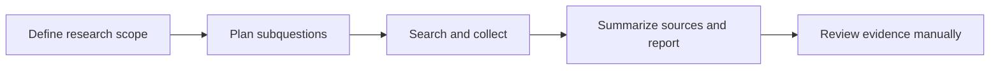

# Research Scout

**An autonomous research Agent with a web interface for vision literature reviews and product competitor analysis.**

A focused research workspace built on [GPT Researcher](https://github.com/assafelovic/gpt-researcher). This edition adds ready-to-fill Chinese research workflows, a Chinese workflow selector, and an evidence review checklist. This README is in English; the domain templates remain in Chinese, and most inherited interface text is in English.

> This project adapts GPT Researcher and preserves the upstream source snapshot, source commit reference, and license. Research Scout is this repository's presentation name. The research engine, internal package names, and most of the interface come from upstream. This edition adds workflow templates, introductory interface text, and validation materials.

## Features

- Enter a topic in the web interface; the Agent breaks it into questions, retrieves sources, and produces a report with citations.
- Use the lightweight browser interface or the existing Next.js interface included upstream.
- Research web pages, local documents, or a combination, depending on configuration, and export reports.
- Choose the Chinese vision-literature or product-diligence template on the home page, fill in its scope, and start the task manually.



The autonomous research engine and report export are implemented upstream. Templates do not guarantee correct conclusions.

## Run locally

Requires **Python 3.12+**. Download and extract the ZIP, or clone this repository and enter the `Research-Scout` directory.

```sh
python3 -m venv .venv
source .venv/bin/activate
python -m pip install -r requirements.txt
cp .env.example .env
```

On Windows, activate the environment with `.venv\Scripts\activate` and copy the file with `copy .env.example .env`.

Add your own `OPENAI_API_KEY` and `TAVILY_API_KEY` to `.env`, then start the server:

```sh
python -m uvicorn main:app --host 127.0.0.1 --port 8000
```

Open [http://127.0.0.1:8000](http://127.0.0.1:8000). This is the actual lightweight interface served by the upstream FastAPI application; no frontend build is needed. Replace the template's `{{...}}` variables before clicking Start Researching. Selecting a template alone does not start a research task.

**Configuration and external service access are required.** The default setup uses model and search services. Research tasks call external APIs and may incur charges; consult your selected providers' actual billing terms. For this edition, dependencies were not installed, keys were not configured, paid research was not run, and model weights were not downloaded. The server may send questions and source excerpts to model providers. When using local documents, check how your selected model service handles that data as well.

To use other models, follow the [upstream model configuration guide](docs/docs/gpt-researcher/gptr/config.md) and set `FAST_LLM`, `SMART_LLM`, and `STRATEGIC_LLM`. Compatible services can use `OPENAI_BASE_URL`. Not every provider has been validated here.

Optional Docker deployment uses the existing [docker-compose.yml](docker-compose.yml); see the [upstream Docker guide](docs/docs/gpt-researcher/getting-started/getting-started-with-docker.md). The default configuration starts the backend on port 8000 and the Next.js interface on port 3000. Container builds have not been tested for this edition.

## Two ready-to-fill workflows

| Workflow | Output |
|---|---|
| [Vision literature review](scout/vision-literature.md) | Method comparisons, dataset splits, metric definitions, code and weight licenses, and reproducibility gaps |
| [Product competitor diligence](scout/competitor-diligence.md) | User problems, competing products, verifiable capabilities and prices, untested assumptions, and a minimal interview plan |

Both domain templates are in Chinese. The machine-readable versions are in [scout-workflows.json](frontend/scout-workflows.json). The home-page selector only fills the research question and does not call a model automatically. Review the completed report using the Chinese [evidence checklist](scout/evidence-review.md).

### Product directions to explore

These are product ideas, **not validated market opportunities or implemented features**:

- **Vision research radar:** Organize low-light enhancement or monocular 3D detection papers for small research teams and produce reproducibility checklists.
- **Lab procurement intelligence:** Compare publicly documented compute configurations, billing rules, and documentation differences to prepare purchasing questions.
- **Domain-specific competitor assistant:** Organize public product updates, target users, and evidence links before conducting human interviews.

## Validation and maintenance

```sh
python3 scout/verify.py
python3 scout/audit_snapshot.py
```

The offline checks validate template variables, report types, interface wiring, and the upstream README snapshot. Validation for this edition covers the added templates, static interface integration, configuration structure, and preservation of licensing materials. **The upstream research engine has not been run end to end.** No sample reports were generated. Upstream demos and evaluations in this repository are not results independently reproduced by this edition's author.

The six inherited GitHub Actions workflows are manual-only to avoid automatically running upstream deployments, container builds, or large test suites on upload. The new `Scout content checks` workflow performs dependency-free offline content checks and does not call model or cloud services.

## Provenance and license

- Upstream: [assafelovic/gpt-researcher](https://github.com/assafelovic/gpt-researcher)
- Source commit: [`0957c301ed06c2a5857b834358c7227c739041d4`](https://github.com/assafelovic/gpt-researcher/commit/0957c301ed06c2a5857b834358c7227c739041d4)
- [Original README snapshot](docs/UPSTREAM_README.md) · [Upstream contribution guide](CONTRIBUTING.md) · [License](LICENSE)

This repository publishes the current source snapshot from the referenced commit together with this edition's changes. Older upstream commits contained historical credentials detected by GitHub, so the full history was not republished. The old history is retained only in a separate local backup; push protection was not bypassed. Credentials and signing fields were removed from one expired signed URL in the current snapshot. That cleanup does not constitute a new evaluation of the dataset.

The upstream `LICENSE` file (Apache-2.0) and copyright information are preserved. The upstream `pyproject.toml` license fields say MIT, which differs from the LICENSE file. Both are retained and the discrepancy is documented here; this edition does not independently change upstream licensing. New templates and interface integration are provided under the repository's LICENSE. The Research Scout name does not imply official endorsement by upstream or any company.
